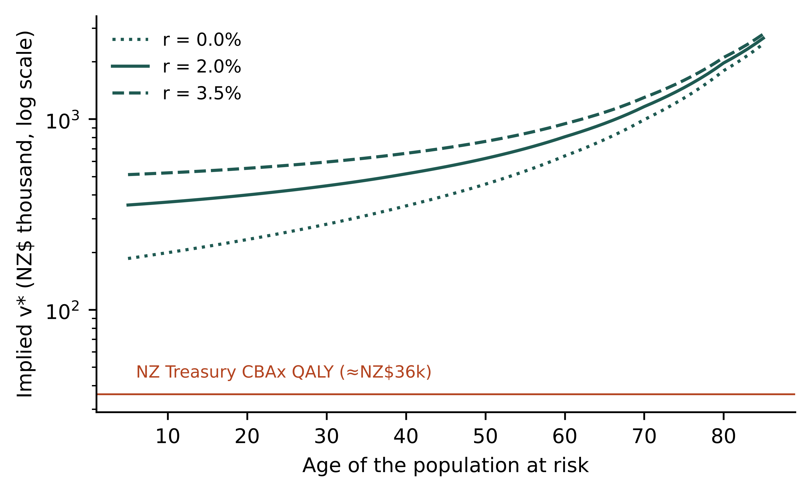

**Target journal:** *Journal of Health Economics* (alternatively *Journal of Benefit-Cost Analysis*).
**JEL codes:** I18, H43, D61, J17.
**Keywords:** value of a statistical life; QALY; cost-effectiveness threshold; shadow price of public funds; life-cycle model; benefit–cost analysis.

---

# Abstract

Public agencies value health with numbers that differ by an order of magnitude. In New Zealand, the transport agency's value of a statistical life (VSL), spread over a 40-year-old's discounted quality-adjusted life expectancy, implies about NZ\$516,000 per quality-adjusted life-year (QALY). The Treasury's cost–benefit tool uses about NZ\$36,000.

We show that, in a standard life-cycle model with fair annuities, the VSL and willingness to pay (WTP) for morbidity reductions are the same parameter multiplied by different quantities of health. That parameter is a common value of a healthy year, $v^*$. The result requires two conditions:

- utility levels are proportional to health-related quality of life at the reference consumption level;
- the marginal utility of consumption does not depend on health.

The two conditions are separable and individually testable. When the second fails, the VSL can only *exceed* its QALY-consistent benchmark, whatever the direction of the health dependence, and the excess is second-order.

We add three further elements:

- a context premium, decomposed into a welfare-relevant anxiety component and a misperception component with different age profiles;
- a scope-insensitivity artefact;
- a budget-constrained public sector with sector-specific shadow prices.

Together these yield an exact multiplicative decomposition of the observed gap into six interpretable factors. Each factor is separately identified by an empirical design we describe. Calibrated to New Zealand values, the decomposition shows that discounting and quality adjustment widen rather than narrow the gap. Plausible combinations of context premia, measurement artefacts and an undersized health budget reconcile it. The decomposition yields a decision rule that agencies can share: value health at $v^*$, apply only endorsed context premia, and convert budget costs at published sector shadow prices.

---

# 1 Introduction

Governments routinely value reductions in mortality and morbidity, and they do so inconsistently. Transport and environmental regulators use a value of a statistical life (VSL): the marginal rate of substitution between wealth and mortality risk, aggregated over a population [@jones1974value; @viscusi2018pricing]. Health technology assessment uses a cost-per-QALY threshold. On the most defensible interpretation, this is the marginal cost at which a budget-constrained health system produces health [@claxton2015methods]. Central agencies often publish a third value. NZ Treasury's CBAx model values a QALY at about NZ\$36,000. Waka Kotahi NZ Transport Agency values a statistical life at NZ\$12.5 million [@denne2023rr698].

Expressed per discounted QALY at age 40, the transport value is roughly fourteen times the Treasury value. Gaps of this size are not peculiar to New Zealand [@tengs1995five; @robinson2019global]. They imply that reallocating a dollar between agencies could buy many times more health, unless the gap reflects something that should differ between agencies.

Two literatures bear on the problem.

- **When CEA and CBA agree.** One asks when cost-effectiveness analysis (CEA) and cost–benefit analysis (CBA) coincide. Pliskin, Shepard and Weinstein [-@pliskin1980utility] gave conditions for QALYs to represent preferences over health profiles. Bleichrodt and Quiggin [-@bleichrodt1999life] showed that, in a life-cycle model, CEA is consistent with CBA only under restrictive conditions on the joint utility of consumption and health. Dolan and Edlin [-@dolan2002bridge] concluded that a bridge between the two requires assumptions so strong that it may not be worth building. Hammitt [-@hammitt2002qalys] showed how QALYs and WTP diverge.
- **WTP per QALY in practice.** The other literature estimates WTP per QALY directly. Estimates span more than an order of magnitude [@hirth2000wtp; @ryen2015wtp; @mason2009modelling].

We take a different approach. We do not ask whether the bridge holds exactly. We ask how far it fails, and in which identifiable ways. Our contributions are four.

1. **Separate conditions** (Proposition 1). We separate the conditions for a common value of a healthy year into a *level* condition (utility proportional to quality at reference consumption) and a *marginal* condition (health-independent marginal utility of consumption). The familiar multiplicative form $u = Q(h)w(c)$ satisfies the first but violates the second. In a model with optimal consumption, it weights future years by a power of quality set by the curvature of utility, not by quality itself (Remark 1).
2. **A one-signed, second-order bias** (Proposition 3). When the marginal condition fails, the VSL is bounded below by its QALY-consistent benchmark, whichever way health shifts marginal utility, and the deviation is second-order. Empirical evidence that ill health lowers the marginal utility of consumption [@finkelstein2013wealth] therefore cannot explain large gaps between VSLs and QALY values.
3. **Context premia with age profiles** (Proposition 4). We model context premia as the sum of an anxiety component, which is a welfare cost that belongs in appraisal, and a probability-misperception component, which does not. The two have different age profiles, so the welfare-relevant share can be estimated rather than assumed.
4. **An exact decomposition** (Theorem 1). Adding scope artefacts and sector shadow prices from a budget-constrained public sector (Proposition 6) gives an exact multiplicative decomposition of the observed gap and a decision rule that agencies can share.

Section 2 sets out the model. Section 3 derives the common value of a healthy year and its failure modes. Section 4 introduces context premia and measurement artefacts. Section 5 adds the public sector. Section 6 states the decomposition and calibrates it to New Zealand. Section 7 discusses identification and policy. Proofs are in the Appendix.

# 2 Model

## 2.1 Preferences and resources

Consider a person of age $a$ facing a survival function $S_a(t)$, $t \ge a$, with $S_a(a) = 1$. Health follows an exogenous path $h(t)$. The person chooses consumption $c(t)$ and has instantaneous utility $u(c,h)$, normalised so that the utility of death is zero. Thus $u(c,h) > 0$ means life in state $h$ with consumption $c$ is preferred to death, and $u(c,h) < 0$ allows states worse than death. We assume $u$ is twice continuously differentiable and strictly concave in $c$.

The person has financial wealth $W_a$ and income $y(t)$, and has access to actuarially fair annuities [@yaari1965uncertain]. The interest rate equals the rate of time preference, $r = \rho$. Expected lifetime utility and the budget constraint are

$$V_a = \int_a^\infty e^{-r(t-a)} S_a(t)\, u\big(c(t), h(t)\big)\, dt, \qquad \int_a^\infty e^{-r(t-a)} S_a(t)\, \big[c(t) - y(t)\big]\, dt = W_a .$$

Let $\mu$ be the multiplier on the budget constraint, the marginal utility of wealth. The first-order condition is

$$u_c\big(c(t), h(t)\big) = \mu \quad \text{for all } t. \qquad (1)$$

## 2.2 Health measures

Let $h^*$ denote full health. A quality-of-life index $Q(h)$ has $Q(h^*) = 1$ and $Q = 0$ for states equivalent to death. Define discounted life expectancy and discounted quality-adjusted life expectancy:

$$\text{DLE}_a = \int_a^\infty e^{-r(t-a)} S_a(t)\, dt, \qquad \text{DQALE}_a = \int_a^\infty e^{-r(t-a)} S_a(t)\, Q\big(h(t)\big)\, dt .$$

## 2.3 The value of a statistical life

A mortality-risk reduction of size $\varepsilon$ at age $a$ scales the survival function from $S_a(t)$ to $(1+\varepsilon)S_a(t)$ for $t > a$. The VSL is the marginal rate of substitution between $\varepsilon$ and wealth, evaluated at $\varepsilon = 0$.

**Lemma 1** [@rosen1988value; @murphy2006value]. With fair annuities and $r = \rho$,

$$\text{VSL}_a = \int_a^\infty e^{-r(t-a)} S_a(t)\, \nu(t)\, dt, \qquad \nu(t) = \frac{u\big(c(t),h(t)\big)}{\mu} + y(t) - c(t). \qquad (2)$$

The integrand $\nu(t)$ is the *value of a life-year* at age $t$. It is the consumption equivalent of being alive in that year, plus the person's net contribution to resources. The second term reflects the annuity market: a person who survives also continues to consume from, and contribute to, the annuity pool [@meltzer1997accounting].

# 3 A common value of a healthy year

## 3.1 Two conditions

**Assumption L (level condition).** There is a reference consumption level $\bar c$ such that $u(\bar c, h) = Q(h)\, u(\bar c, h^*)$ for all $h$.

**Assumption M (marginal condition).** The marginal utility of consumption does not depend on health: $u_c(c, h) = u_c(c, h^*)$ for all $c$ and $h$.

Assumption L is the standard condition under which QALYs represent preferences over health at fixed consumption [@pliskin1980utility]. Assumption M rules out state dependence in the marginal utility of money. Under M, condition (1) implies that consumption is constant over life at some level $\bar c$, and we take that level as the reference in L.

Define the **common value of a healthy year**

$$v^* \equiv \frac{u(\bar c, h^*)}{u_c(\bar c, h^*)},$$

the consumption equivalent of a year in full health at the reference consumption level. Define the **net contribution** $\text{NC}_a = \int_a^\infty e^{-r(t-a)} S_a(t)\,[y(t) - \bar c]\,dt$.

## 3.2 Main result

**Proposition 1 (common value).** Under Assumptions L and M:

(i) $\text{VSL}_a = v^* \cdot \text{DQALE}_a + \text{NC}_a$.

(ii) Consider a small health improvement $\Delta h(t)$ that raises quality by $\Delta Q(t) = Q'(h(t))\,\Delta h(t)$. The WTP for it is, to first order, $v^* \int_a^\infty e^{-r(t-a)} S_a(t)\, \Delta Q(t)\, dt$.

(iii) Consequently, the net VSL per discounted QALY, $(\text{VSL}_a - \text{NC}_a)/\text{DQALE}_a$, is independent of age and equals the WTP per discounted QALY for morbidity improvements.

Part (iii) gives two observable restrictions: invariance in age, and equality across mortality and morbidity valuations. Both are testable in a single survey.

**Remark 1 (multiplicative separability is not enough).** The common specification $u(c,h) = Q(h)\,w(c)$ satisfies L but not M, because $u_c = Q(h)\,w'(c)$. Condition (1) then gives $Q(h(t))\,w'(c(t)) = \mu$, so consumption moves with health. The value of a life-year becomes $\nu(t) = w(c(t))/w'(c(t)) + y(t) - c(t)$: health enters only through consumption.

With power utility $w(c) = c^{1-\eta}/(1-\eta)$ and $\eta < 1$, $\nu(t)$ is proportional to $Q(h(t))^{1/\eta}$ plus the net-contribution term. This is not proportional to $Q$ unless $\eta = 1$, the limit in which $w$ is unbounded below. Under multiplicative separability, the VSL therefore weights future years by a power of quality that depends on the curvature of utility. Analysts who quality-adjust a VSL by dividing by DQALE are implicitly assuming M, not merely L. This sharpens the observation of Bleichrodt and Quiggin [-@bleichrodt1999life] that CEA and CBA agree only under restrictive conditions: the binding restriction is on *marginal* utility.

## 3.3 When the marginal condition fails

Evidence suggests that the marginal utility of consumption falls when health deteriorates [@finkelstein2013wealth], violating M. How large a bias does this create?

Keep Assumption L at the full-health consumption level $\bar c$, defined by $u_c(\bar c, h^*) = \mu$. Drop Assumption M. Define $\overline{\text{NC}}_a = \int e^{-r(t-a)} S_a(t)\,[y(t) - \bar c]\,dt$.

**Proposition 2 (one-signed bias).** Under Assumption L and strict concavity of $u$ in $c$, with $c(t)$ chosen optimally, for every $t$

$$\nu(t) \;\ge\; v^*\, Q\big(h(t)\big) + y(t) - \bar c,$$

with equality if and only if $c(t) = \bar c$. Hence $\text{VSL}_a \ge v^* \cdot \text{DQALE}_a + \overline{\text{NC}}_a$.

The bias is one-signed whichever way health shifts marginal utility. If poor health lowers marginal utility, consumption falls in poor health; if it raises it, consumption rises. Either way, the option to reallocate consumption across states makes a life-year worth more than its QALY-consistent benchmark, by a revealed-preference argument.

**Proposition 3 (the bias is second-order).** Suppose utility is locally isoelastic in consumption with curvature $\eta = -\bar c\, u_{cc}/u_c$, and optimal consumption in year $t$ deviates from $\bar c$ by a proportion $\delta_t$. Then

$$\nu(t) - \big[v^* Q(h(t)) + y(t) - \bar c\big] = \tfrac{\eta}{2}\, \delta_t^2\, \bar c + o(\delta_t^2).$$

For example, take $\eta = 1.5$, a 20% fall in consumption during poor health ($\delta = 0.2$), and $v^*/\bar c = 3$, a ratio typical of VSL-based values per life-year relative to consumption per head. The bias is about 1% of the value of a healthy year. State dependence of the size found empirically cannot account for gaps between VSLs and QALY values measured in multiples.

We summarise the deviation in a single factor:

$$\sigma_a \equiv \frac{\text{VSL}_a - \overline{\text{NC}}_a}{v^*\,\text{DQALE}_a} \;\ge\; 1. \qquad (3)$$

# 4 Context premia and measurement artefacts

## 4.1 Context premia

Observed VSLs differ across hazards. Stated-preference studies find premia for deaths that are dreaded, involuntary or caused by others [@chilton2002perceptions; @hammitt2010children]. We distinguish two sources.

**Anxiety.** While exposed to hazard $k$ over a window $[a, a+T]$, the person bears a flow disutility $\alpha_k\, p_k$, proportional to the annual risk $p_k$. Reducing $p_k$ reduces both the risk of death and the anxiety. Anxiety is a genuine welfare cost [@portney1992trouble].

**Misperception.** The person perceives a risk change $\Delta p$ as $\omega_k\, \Delta p$, with $\omega_k > 1$ for vivid or dreaded hazards. Stated WTP then reflects the perceived rather than the actual change. Misperceived risks are not welfare-relevant: a benevolent planner would correct the belief rather than pay for it.

**Proposition 4 (context premia).** Let $\text{VSL}^0_a$ be the VSL in a neutral context (Lemma 1) and $D_{a,T} = \int_a^{a+T} e^{-r(t-a)} S_a(t)\,dt$. The VSL inferred from WTP for a reduction in hazard $k$ is

$$\text{VSL}_{k,a} = \omega_k\left[\text{VSL}^0_a + \frac{\alpha_k}{\mu}\, D_{a,T}\right] \equiv \pi_{k,a}\, \text{VSL}^0_a,$$

with

$$\pi_{k,a} = \omega_k\left(1 + \frac{\alpha_k D_{a,T}}{\mu\, \text{VSL}^0_a}\right).$$

The misperception factor $\omega_k$ is constant in age. The anxiety factor rises with age whenever $D_{a,T}/\text{VSL}^0_a$ does: when the exposure window is short relative to remaining life, so that the premium is spread over fewer remaining healthy years.

The age gradient of $\pi_{k,a}$ therefore separates the welfare-relevant anxiety premium from the misperception premium. Only the anxiety premium belongs in appraisal.

## 4.2 Scope insensitivity

Theory implies that WTP for small risk reductions is proportional to the reduction. Stated-preference responses often are not [@johnston2017guidance]. Suppose stated WTP for a risk reduction $\Delta p$ satisfies $\text{WTP}^s = \beta\, \Delta p^{\theta}$ with $0 < \theta \le 1$. The implied VSL is $\beta\, \Delta p^{\theta - 1}$, so it depends on the size of the risk reduction asked about.

**Proposition 5 (measurement factor).** Suppose a VSL is estimated from a survey that asks about risk reductions of size $\Delta p_s$, and is applied to policies whose risk changes are of size $\Delta p_0$. The ratio of the reported value to the value that would be elicited at the policy-relevant scale is

$$M = \left(\frac{\Delta p_s}{\Delta p_0}\right)^{\theta - 1}.$$

$M > 1$ whenever $\theta < 1$ and $\Delta p_s < \Delta p_0$. With $\theta = 0.5$, a survey that asks about risk reductions one ninth the size of the policy-relevant change overstates the VSL threefold. Split-sample external scope tests identify $\theta$.

# 5 Public budgets and sector shadow prices

Agencies do not spend private income. Let sectors $s = 1, \dots, S$ have budgets $G_s$. A project $j$ in sector $s(j)$ costs the sector $C_j$ and delivers discounted QALYs $\Delta Q_{jk}$ in context $k$ and consumption-equivalent non-health benefits $\Delta Y_j$. Its social benefit is

$$B_j = v^* \sum_k \tilde\pi_k\, \Delta Q_{jk} + \Delta Y_j,$$

where $\tilde\pi_k$ is the welfare-relevant (anxiety) context premium, with misperception removed. The planner solves the relaxed problem

$$\max_{x \in [0,1]^J} \sum_j x_j B_j \quad \text{s.t.} \quad \sum_{j:\, s(j) = s} x_j C_j \le G_s \quad \forall s .$$

**Proposition 6 (decision rule and shadow prices).** Let $\lambda_s \ge 0$ be the multiplier on sector $s$'s budget.

(i) An optimal portfolio funds project $j$ if $B_j > \lambda_{s(j)} C_j$ and does not fund it if $B_j < \lambda_{s(j)} C_j$.

(ii) For pure health projects ($\Delta Y_j = 0$, $\tilde\pi = 1$), the rule is a cost-per-QALY threshold $k_s = v^* / \lambda_s$, so $\lambda_s = v^*/k_s$.

(iii) Suppose budgets are financed by distortionary taxation with marginal cost of public funds $\gamma$ and are themselves chosen optimally. Then $\lambda_s = \gamma$ for every sector with positive spending. With fixed budgets, moving $dG$ from sector $s$ to sector $s'$ changes welfare by $(\lambda_{s'} - \lambda_s)\, dG$ to first order.

Part (ii) reinterprets the supply-side threshold literature [@claxton2015methods; @lomas2019marginal]. A health-sector threshold below $v^*$ is evidence that $\lambda_{\text{health}} > 1$, meaning the health budget is constrained. It is not evidence that health is worth less in the health sector than elsewhere. Part (iii) states the efficiency condition that inconsistent valuation violates [@dahlby2008mcpf].

# 6 The decomposition

## 6.1 Theorem

Combine the observed (stated) VSL for context $k$ at age $a$ with a health-sector threshold $k_h$, and define the observed gap per undiscounted life-year:

$$G \equiv \frac{\text{VSL}^{\text{obs}}_{k,a}}{k_h \cdot \text{LE}_a}.$$

**Theorem 1 (exact decomposition).** Under the definitions above, with $\text{VSL}^{\text{obs}}_{k,a} = M\, \pi_{k,a}\, \text{VSL}^0_a$, $\sigma_a$ as in (3), $N_a \equiv 1 + \overline{\text{NC}}_a / (\sigma_a v^* \text{DQALE}_a)$ and $\lambda_h = v^*/k_h$,

$$G \;=\; \underbrace{\frac{\text{DQALE}_a}{\text{LE}_a}}_{\text{arithmetic}} \times \underbrace{N_a}_{\text{net contribution}} \times \underbrace{\sigma_a}_{\text{state dependence}} \times \underbrace{\pi_{k,a}}_{\text{context}} \times \underbrace{M}_{\text{measurement}} \times \underbrace{\lambda_h}_{\text{opportunity cost}} .$$

The identity follows from the definitions. Its content lies in Propositions 1–6:

- each factor has a theoretical interpretation and a known sign or bound: arithmetic factor $< 1$ when $r > 0$ or $Q < 1$; $\sigma_a \ge 1$ and close to 1; $\pi_{k,a} = \omega_k \times$ (anxiety term); $M \ge 1$ under scope insensitivity; $\lambda_h \ge 1$ for an undersized budget;
- each is separately identified (Section 7.1).

## 6.2 Calibration to New Zealand

Take the NZTA VSL (NZ\$12.5m) and the CBAx QALY value (NZ\$36,000) as $k_h$. For a 40-year-old, remaining life expectancy is about 43.6 years and discounted quality-adjusted life expectancy at 2% is about 24.2. These figures use approximate NZ period life tables and illustrative age norms for quality of life. Then:

- $G = 7.96$;
- the arithmetic factor is $0.556$;
- the remaining factors must multiply to $14.3$.

Treat $N_a \approx 1$, as standard reference cases do [@robinson2019global], and $\sigma_a \in [1, 1.02]$ by Proposition 3. Then $\pi \times M \times \lambda_h \approx 14.3$. Table 1 shows three illustrative reconciliations.

**Table 1.** Illustrative reconciliations of the NZ gap (age 40, $r$ = 2%, $N = \sigma = 1$).

| Scenario | $\pi$ | $M$ | $\lambda_h$ | Implied $v^*$ (NZ\$) | Implied $k_h = v^*/\lambda_h$ |
|---|---:|---:|---:|---:|---:|
| A. Budget explains all | 1.0 | 1.0 | 14.3 | 516,000 | 36,000 |
| B. Measurement and budget | 1.2 | 3.0 | 4.0 | 143,000 | 36,000 |
| C. Context, measurement and budget | 2.0 | 1.5 | 4.8 | 172,000 | 36,000 |

Scenario B is notable. Its implied $v^*$ is close to the UK Green Book value of a QALY (about £70,000, roughly NZ\$133,000), and its shadow price $\lambda_h = 4$ is of the order implied by comparing supply-side thresholds with demand-side values in the UK [@claxton2015methods]. None of the scenarios is an estimate. The point is that the gap is reconcilable with plausible magnitudes, and that its policy meaning depends on *which* factors are large. Under Scenario A, the health budget is about fourteen times too small at the margin. Under Scenario B, the transport value is about three times too high because of measurement, and the health budget about four times too small.

## 6.3 Age profiles

Figure 1 plots the $v^*$ implied by an age-invariant VSL, $\text{VSL}/\text{DQALE}_a$, against the age of the population at risk. Under Proposition 1, $v^*$ should be flat. An age-invariant VSL implies that $v^*$ more than triples between ages 10 and 70: from about NZ\$367,000 to NZ\$1.16 million at 2%.

One of two things must therefore give. Either the VSL should decline with age, as in the life-year (VSLY) approaches used in some appraisals [@aldy2008adjusting], or the common value of a healthy year is not common across ages, which contradicts the conditions for consistent QALY valuation. The survey proposed in Section 7 tests this directly (hypothesis H1).

# 7 Identification and policy

## 7.1 Identification

Each factor in Theorem 1 is identified by a distinct contrast that can be built into one stated-preference survey, plus supply-side estimation.

| Factor | Identifying contrast |
|---|---|
| Arithmetic | Life tables, respondents' subjective survival, and their own time trade-off quality weights |
| $\sigma_a$ (with $v^*$) | Equality of net VSL per DQALE across ages and with morbidity WTP per QALY (Proposition 1(iii)); deviations are bounded below by Proposition 2 |
| $\omega_k$ vs anxiety | Age gradient of the context premium (Proposition 4) and a risk-perception module |
| $M$ | External split-sample scope test giving $\theta$ (Proposition 5) |
| $\lambda_h$ | Marginal productivity of health spending using formula-driven variation [@lomas2019marginal]; revealed thresholds [@devlin2004nice] |
| $N_a$ | Income and consumption profiles; conventionally set to 1 |

## 7.2 A rule agencies can share

Proposition 6 suggests a reporting standard. Agencies report health effects in discounted QALYs by context and value them using three published parameters:

1. the common value of a healthy year $v^*$;
2. a short list of welfare-relevant context premia $\tilde\pi_k$;
3. sector shadow prices $\lambda_s$.

Current practice is nested within this rule:

- **Transport appraisal** sets $\lambda = 1$ and embeds $M \pi$ in a single VSL applied without age adjustment.
- **Health technology assessment** reports $k_h = v^*/\lambda_h$ without separating its components.

Publishing the components separately makes visible the judgements now hidden in single numbers. It also turns cross-sector inconsistency into what it should be: an explicit budget question.

## 7.3 Relation to welfare criteria

The decision rule aggregates WTP and is therefore a Kaldor–Hicks criterion. With heterogeneous incomes, a single $v^*$ is a population-average value, and equity weights can be introduced through a social welfare function [@adler2014social]. Equivalent-income approaches offer an alternative that respects individual trade-offs without utilitarian aggregation [@fleurbaey2013equivalent]. The decomposition applies unchanged if $v^*$ is replaced by a weighted value; only the interpretation of $\lambda_s$ changes.

## 7.4 Limitations

- **Expected utility, fair annuities and $r = \rho$.** These are the standard assumptions behind Lemma 1. Without annuities, the net-contribution term changes form but remains separable.
- **Exogenous health.** Health is exogenous to consumption. With health investment [@murphy2006value], $v^*$ also reflects the shadow value of health capital.
- **Relaxed public problem.** Proposition 6 relaxes integer project choices. For lumpy projects the rule holds for marginal projects only approximately.
- **Calibration inputs.** The NZ calibration uses approximate life tables and illustrative quality norms. It is meant to show orders of magnitude, not to estimate anything.

# 8 Conclusion

A value of a statistical life and a value of a QALY are not rival measures of the same thing. Under conditions we make precise, they are one parameter, the common value of a healthy year, applied to different quantities of health. When the conditions fail, they fail in identifiable directions:

- state dependence can only raise the VSL, and only slightly;
- context premia mix a welfare-relevant anxiety cost with a misperception that should be removed, and the two have different age profiles;
- scope insensitivity inflates stated values in a predictable way;
- budget constraints lower supply-side thresholds without lowering the value of health.

The resulting decomposition converts a single unexplained gap into a list of estimable parameters and a decision rule that every agency can share.

---

# Appendix: Proofs

**Proof of Lemma 1.** Write the Lagrangian with the survival function scaled by $(1+\varepsilon)$ for $t > a$:

$$\mathcal{L} = (1+\varepsilon)\int e^{-r(t-a)} S_a u\, dt + \mu\Big[W_a - (1+\varepsilon)\int e^{-r(t-a)} S_a (c - y)\,dt\Big].$$

By the envelope theorem, $d V_a / d\varepsilon = \int e^{-r(t-a)} S_a u\,dt - \mu \int e^{-r(t-a)} S_a (c - y)\, dt$. Dividing by $\mu = \partial V_a / \partial W_a$ gives the marginal rate of substitution (2). ∎

**Proof of Proposition 1.**

(i) Under M, condition (1) implies $u_c(c(t), h^*) = \mu$ for all $t$. By strict concavity, $c(t) = \bar c$ is constant, with $u_c(\bar c, h^*) = \mu$. Under L, $u(\bar c, h(t)) = Q(h(t))\, u(\bar c, h^*)$. Substituting into (2) gives $\nu(t) = Q(h(t))\, v^* + y(t) - \bar c$. Integrating gives (i).

(ii) A health improvement $\Delta h$ changes $V_a$ by $\int e^{-r(t-a)} S_a\, u_h(\bar c, h)\, \Delta h\, dt$. Consumption is unaffected to first order because, under M, condition (1) is independent of $h$. Differentiating L with respect to $h$ at $\bar c$ gives $u_h(\bar c, h) = Q'(h)\, u(\bar c, h^*)$. Dividing by $\mu$ gives WTP $= v^* \int e^{-r(t-a)} S_a\, \Delta Q\, dt$.

(iii) This follows from (i) and (ii). ∎

**Proof of Remark 1.** With $u = Q w$, condition (1) gives $Q(h(t))\, w'(c(t)) = \mu$, and $\nu(t) = Q w(c)/\mu + y - c = w(c)/w'(c) + y - c$. With $w = c^{1-\eta}/(1-\eta)$, $w/w' = c/(1-\eta)$ and $c(t) = (Q(h(t))/\mu)^{1/\eta}$. So $\nu(t) - (y - c) \propto Q^{1/\eta}$. ∎

**Proof of Proposition 2.** By strict concavity of $u(\cdot, h)$, $u(\bar c, h) \le u(c, h) + u_c(c, h)(\bar c - c)$, with equality if and only if $c = \bar c$. Evaluate at $h = h(t)$ and $c = c(t)$, and use (1) to replace $u_c(c(t), h(t))$ by $\mu$:

$$u(c(t), h(t)) \ge u(\bar c, h(t)) + \mu\,(c(t) - \bar c).$$

By L, $u(\bar c, h(t)) = Q(h(t))\, \mu\, v^*$. Dividing by $\mu$ and adding $y(t) - c(t)$ to both sides gives $\nu(t) \ge Q(h(t))\, v^* + y(t) - \bar c$. Integrating gives the bound on $\text{VSL}_a$. ∎

**Proof of Proposition 3.** A second-order Taylor expansion of $u(\bar c, h)$ around $c(t)$ gives

$$u(\bar c, h) = u(c, h) + u_c(c, h)(\bar c - c) + \tfrac12 u_{cc}(\tilde c, h)(\bar c - c)^2$$

for some $\tilde c$ between $c$ and $\bar c$. Rearranging as in the proof of Proposition 2, the gap equals $-\tfrac12 u_{cc}(\tilde c,h)(\bar c - c)^2/\mu$. With $c(t) = \bar c(1 + \delta_t)$ and local isoelasticity, $-u_{cc}/\mu = \eta/\bar c + O(\delta_t)$, so the gap is $\tfrac{\eta}{2}\delta_t^2 \bar c + o(\delta_t^2)$. ∎

**Proof of Proposition 4.** With anxiety, flow utility during exposure is $u - \alpha_k p_k$. A reduction $\varepsilon$ in the annual risk $p_k$ raises survival as in Lemma 1 and reduces disutility by $\alpha_k \varepsilon$ per year of exposure. The envelope argument adds $\alpha_k \int_a^{a+T} e^{-r(t-a)} S_a\, dt$ to $dV_a/d\varepsilon$. With misperception, the person's valuation applies to $\omega_k \varepsilon$ rather than $\varepsilon$, which scales WTP by $\omega_k$. Dividing by $\mu$ and by $\text{VSL}^0_a$ gives $\pi_{k,a}$. The age statement follows because $\omega_k$ does not depend on $a$, while the anxiety term is proportional to $D_{a,T}/\text{VSL}^0_a$. ∎

**Proof of Proposition 5.** The reported VSL is $\beta\Delta p_s^{\theta-1}$ and the value at the policy-relevant scale is $\beta \Delta p_0^{\theta - 1}$. Their ratio is $M$. ∎

**Proof of Proposition 6.**

(i) The relaxed problem is a linear programme. The Karush–Kuhn–Tucker conditions are $B_j - \lambda_{s(j)} C_j - \phi_j + \psi_j = 0$, with $\phi_j \ge 0$ the multiplier on $x_j \le 1$ and $\psi_j \ge 0$ the multiplier on $x_j \ge 0$, plus complementary slackness. They imply $x_j = 1$ when $B_j > \lambda_{s(j)} C_j$ and $x_j = 0$ when $B_j < \lambda_{s(j)} C_j$.

(ii) For pure health projects, $B_j = v^* \Delta Q_j$, so the funding condition $B_j \ge \lambda_s C_j$ is equivalent to $C_j/\Delta Q_j \le v^*/\lambda_s$.

(iii) If budgets are chosen to maximise $\sum_j x_j B_j - \gamma \sum_s G_s$, the first-order condition for $G_s$ is $\lambda_s = \gamma$. With fixed budgets, the envelope theorem gives $\partial W / \partial G_s = \lambda_s$. ∎

---

# References

::: {#refs}
:::
